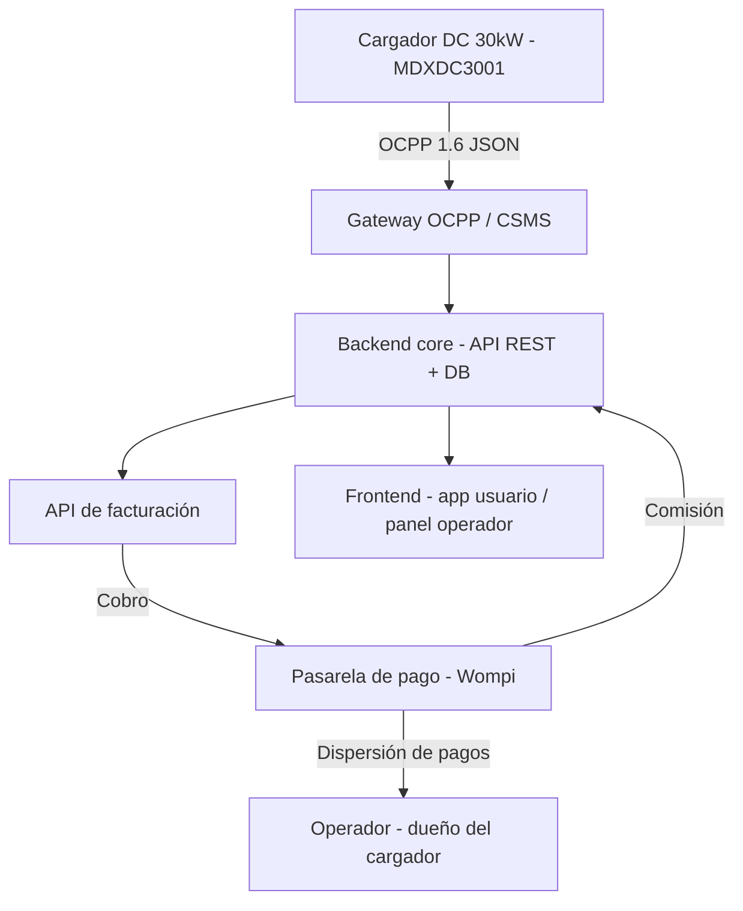

# Electrolineras — Especificación técnica

## 1. Resumen del proyecto

Plataforma de gestión de cargadores eléctricos (backend + frontend) que permite a un
**operador** (dueño de uno o varios cargadores DC, ej. conjuntos residenciales, centros
comerciales u oficinas) registrar su hardware, definir tarifas, y empezar a facturar a
usuarios finales que cargan sus vehículos. La plataforma cobra una comisión configurable
por cada transacción.

Hardware de referencia en manos del equipo: **cargador DC 30kW, modelo MDXDC3001**
(AC 380V±15%, máx. 100A, IP55, protocolo esperado: OCPP 1.6 JSON — a confirmar con el
fabricante).

## 2. Modelo de negocio

- Modelo tipo marketplace/franquicia: "quien tenga nuestro software y nuestro cargador,
  empieza a facturar".
- El **operador** se registra, vincula su(s) cargador(es) por número de serie, y define
  su tarifa (precio por kWh o por sesión).
- El **usuario final** paga por su sesión de carga a través de la app/plataforma.
- La **plataforma** cobra el pago completo vía pasarela de pago y automáticamente
  dispersa el dinero: retiene su comisión y transfiere el resto al operador.
- **Comisión**: configurable por operador (no un valor fijo en código) — queda sujeta a
  negociación comercial caso por caso.

## 3. Arquitectura general

### Componentes

| Componente | Función | Tecnología sugerida |
|---|---|---|
| Gateway OCPP (CSMS) | Habla OCPP 1.6 JSON con el cargador, traduce eventos (inicio, parada, consumo) | Node.js + librería OCPP (ej. `node-ocpp` o similar) sobre WebSockets |
| Backend core | Lógica de negocio, autenticación, modelos de datos, orquestación | Node.js (NestJS) + PostgreSQL |
| API de facturación | Cálculo de costo por sesión, cobro, dispersión de pagos | Integración con Wompi (API de dispersión de pagos) |
| Frontend usuario | Buscar estación, iniciar carga (QR/RFID), pagar, ver recibo | Web (Next.js) y/o app móvil (React Native) |
| Panel operador | Ver cargadores, sesiones activas, ingresos, configurar tarifa y comisión | Web (Next.js) |

## 4. Modelo de datos (borrador inicial)

- **operadores**: id, nombre, datos de contacto, cuenta bancaria/beneficiario para dispersión, comisión_pactada (%)
- **cargadores**: id, operador_id (FK), numero_serie, modelo, ubicación, estado (activo/inactivo/en falla)
- **usuarios**: id, nombre, email, medio de pago (token Wompi)
- **sesiones_carga**: id, cargador_id (FK), usuario_id (FK), inicio, fin, kWh_consumidos, costo_total
- **transacciones**: id, sesion_id (FK), monto_total, comisión_plataforma, monto_operador, estado_pago, referencia_pasarela

## 5. Flujo de facturación

1. Usuario escanea QR/RFID en el cargador → app identifica cargador y operador.
2. Backend inicia sesión de carga vía comando OCPP (`RemoteStartTransaction`).
3. Cargador reporta consumo en tiempo real (`MeterValues`) hasta que el usuario detiene la carga.
4. Backend calcula el costo total según tarifa del operador.
5. Se cobra el monto completo al usuario vía Wompi.
6. Wompi dispersa automáticamente: comisión → cuenta de la plataforma, resto → cuenta del operador.
7. Se genera el recibo/factura para el usuario y el reporte de ingresos para el operador.

## 6. Roadmap de desarrollo

1. Definir arquitectura y stack (✅ Node.js/NestJS + PostgreSQL + Wompi).
2. Confirmar versión OCPP del MDXDC3001 e integrar el gateway con el cargador real.
3. Modelar y construir el backend core (multi-tenant: operadores, cargadores, sesiones).
4. Construir la API de facturación con Wompi (cobro + dispersión de pagos).
5. Desarrollar frontend: panel de operador y app/web de usuario final.
6. Pruebas end-to-end (carga real → cobro → dispersión → recibo) y despliegue.

## 7. Pendientes / decisiones abiertas

- Confirmar con el fabricante la versión exacta de OCPP soportada por el MDXDC3001.
- Definir el criterio comercial de comisión por operador (queda para negociación futura;
  el sistema debe soportarlo como campo configurable desde el día uno).
- Definir si habrá app móvil nativa desde el inicio o se arranca solo con web responsive.
